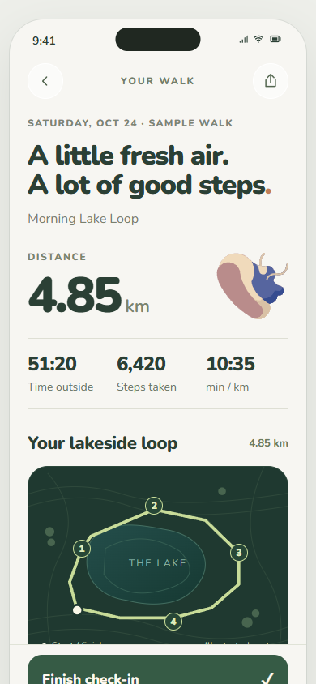

# FitLens — Hướng dẫn demo cho người thuyết trình

**Bản bàn giao: 27/10/2026 · Prototype giao diện mobile · Tiếng Việt cho người demo, giao diện tiếng Anh.**

FitLens giúp người dùng tạo nhịp vận động phù hợp, ghi nhận cảm nhận sau buổi tập và tìm gợi ý ăn uống, kiến thức liên quan. Điểm nhấn là cách trình bày gần gũi: mascot có biểu cảm, số liệu gắn với hình minh họa và không khuyến khích tập bất chấp đau.

Đây là **HTML/CSS/JavaScript prototype tương tác**, chưa phải ứng dụng điện thoại kết nối thiết bị. Đọc mục 1–4 trước để trình bày; các mục sau dùng khi diễn tập hoặc trả lời câu hỏi. Các ảnh bên dưới được chụp từ chính bản sao này. Xem [biên bản kiểm tra](docs/demo/VALIDATION.md) để biết phạm vi đã thử.

## 1. Mở và chuẩn bị trong 5 phút

1. Clone hoặc tải ZIP repo, giải nén; mở terminal tại thư mục có `home.html`.
2. Nếu đã cài Python, chạy:

   ```sh
   python -m http.server 8000 --bind 127.0.0.1
   ```

   Trên Windows có thể dùng `py -m http.server 8000 --bind 127.0.0.1` nếu máy dùng lệnh `py`.
3. Mở [http://127.0.0.1:8000/](http://127.0.0.1:8000/). Nếu máy không có Python, dùng Live Server của VS Code và giữ cùng một địa chỉ trong cả buổi.
4. Dùng Chrome hoặc Edge trên laptop. Nhấn F12 → bật thanh mô phỏng điện thoại → chọn **Responsive, 390 × 844**, mức zoom trang 100%. Thu phóng phần xem trước cho vừa chiều cao màn hình trình chiếu. Không cần giả lập camera hoặc GPS.
5. Đợi font và ảnh hiện đủ. Đóng thông báo hệ điều hành, thử trình chiếu và kiểm tra con trỏ đủ dễ nhìn.
6. Mở sẵn các đường dẫn trong mục 2. Chạy thử các thao tác ở mục 3 trước khi lên lớp.

**Nếu chỉ xem nhanh:** mở `home.html` trực tiếp cũng có thể hiển thị, nhưng demo chính thức nên chạy bằng server để địa chỉ và dữ liệu trình duyệt ổn định. Sau khi server đã chạy và tải trang, các tài nguyên UI chính nằm trong repo; không cần gọi AI, bản đồ hay Health trực tuyến.

## 2. Các trang nên mở sẵn — đẹp nhất và hữu ích nhất

Các URL dưới đây giả định bạn chạy cổng 8000. Nếu dùng Live Server, thay phần địa chỉ đầu, giữ tên file và query string.

| Thứ tự | Mở sẵn | Vì sao nên cho xem |
|---|---|---|
| 1 | [Today với trạng thái mẫu](http://127.0.0.1:8000/home.html?preview=active) | Mascot, màu thương hiệu, nhịp tuần và mặt trời Steps trong bố cục tổng quan. |
| 2 | [Steps / Walk](http://127.0.0.1:8000/steps.html) | Mặt trời vàng cam, thống kê, hai biểu đồ và thẻ kiến thức. |
| 3 | [Recap đi bộ](http://127.0.0.1:8000/post-walk-restored.html) | Route minh họa tương tác, Pace/Elevation/Heart rate và cảm nhận sau đi bộ. |
| 4 | [Food](http://127.0.0.1:8000/food.html?preview=walk) | Ảnh món ăn, danh mục 30 món, công thức, tìm kiếm/lọc, gợi ý theo ngữ cảnh mẫu. |
| 5 | [Recap sau tập](http://127.0.0.1:8000/workout-review.html) | Mascot phản hồi theo độ mệt, hình gấu và các khối tổng kết buổi tập. |
| 6 | [Insights](http://127.0.0.1:8000/insights.html) | Bộ sưu tập recap và các thẻ bài viết sức khỏe có phần đọc. |
| 7 | [Recap năm — điểm nhấn thị giác](http://127.0.0.1:8000/yearly-recap.html) | 11 chương story, chuyển màu, minh họa chuyển động, bản đồ và poster kết thúc. |
| 8 | [Plan](http://127.0.0.1:8000/plan.html) | Luồng sắp lịch/gợi ý tuần có thể tương tác và áp dụng bản nháp. |


**Nếu chỉ có 3 phút:** Today → Steps → recap đi bộ → Insights → 2–3 chương recap năm. Nếu có 5 phút, thêm Food và mascot trong recap sau tập. Nếu chấm nhiều về nghiệp vụ, dùng nhánh Plan ở mục 4 và rút ngắn story.

## 3. Kịch bản trình bày chính — khoảng 5 phút

### 0:00–0:25 — Today: giới thiệu câu chuyện

- **Mở:** `home.html?preview=active`.
- **Thao tác:** cho xem phần đầu và cuộn nhẹ tới nhịp tuần, Today’s activity.
- **Lời dẫn gợi ý:** “FitLens muốn giúp người dùng duy trì vận động phù hợp với cuộc sống. Trang Today gom tiến độ, hoạt động và gợi ý tiếp theo trong một giao diện gần gũi.”
- **Kỳ vọng:** có trạng thái mẫu về tiến độ tuần; mặt trời Steps và các mục dẫn đi được hiển thị. `preview=active` là fixture để diễn tập, không phải thành tích người đang demo.

### 0:25–1:10 — Steps: số liệu có ngữ cảnh

- **Thao tác:** bấm thẻ **Steps**; nhìn mặt trời, cuộn xuống Progress và Short-term overview. Chuyển **Steps → Distance → Flights**. Chỉ thử 1–2 điểm trên Progress để minh họa đọc số liệu.
- **Lời dẫn:** “Số bước được đặt cạnh thói quen thường ngày, không chỉ một ngưỡng cố định. Người dùng có thể xem diễn biến trong ngày và tổng quan nhiều ngày.”
- **Lưu ý:** Steps dùng bộ dữ liệu mẫu cố định tháng 10/2026; “Today” ở màn này không tự chuyển theo ngày máy. Flights là dữ liệu mẫu. Không nói đang đọc trực tiếp Apple Health.
- **Cuộn cuối:** có **Recorded walk** dạng hàng ngang và **More about walking**. Đưa con trỏ vào thẻ bài, mở một bài rồi đóng để cho thấy quay lại nguyên vị trí.


### 1:10–1:55 — Recap đi bộ: route và cảm nhận

- **Mở:** bấm **Morning Lake Loop** trong Recorded walk, hoặc tab recap đi bộ đã mở sẵn.
- **Thao tác:** xem route; kéo **Explore your route**, chuyển **Pace / Elevation / Heart rate**. Cuộn tới **How do you feel now?**, chọn một cảm nhận.
- **Lời dẫn:** “Sau một chuyến đi bộ, người dùng nhìn lại đường đi và diễn biến hoạt động, rồi ghi nhận cơ thể cảm thấy thế nào.”
- **Kỳ vọng:** điểm trên route, giá trị và biểu đồ phản hồi theo thao tác. Route, GPS, độ cao và nhịp tim đều là minh họa.
- **Giới hạn cần biết:** nút **Finish check-in** hiện trình diễn xác nhận/check-in; không dùng nó để chứng minh buổi đi bộ đã tăng Rhythm hoặc tạo một hoạt động thật. Muốn minh họa ghi hoạt động và tăng tiến độ, dùng Activity ở mục 4.



### 1:55–2:35 — Food: chăm sóc cả phần ăn uống

- **Mở:** tab `food.html?preview=walk`.
- **Thao tác:** lướt hàng món gợi ý; chọn một món; xem nguyên liệu và cách làm. Quay lại; nếu cần, tìm `trứng` trong ô **Dish or ingredient**.
- **Lời dẫn:** “Gợi ý món ăn được gắn với ngữ cảnh sinh hoạt. Người dùng có thể tìm món, xem công thức và ghi lại bữa ăn thay vì phải nhập calo chính xác.”
- **Lưu ý:** preview Walk là ngữ cảnh giả lập; danh mục và luật gợi ý chạy cục bộ. Đây chưa phải tư vấn dinh dưỡng cá nhân từ AI. Ảnh món ăn là tài nguyên demo; không tuyên bố toàn bộ ảnh do nhóm chụp.


### 2:35–3:10 — Recap sau tập: mascot và phản hồi cơ thể

- **Mở:** tab `workout-review.html`.
- **Thao tác:** cho xem các khối tổng kết; kéo thanh đánh giá độ mệt qua vài mức rồi dừng ở mức vừa. Quan sát mascot.
- **Lời dẫn:** “FitLens hỏi cảm nhận sau tập, không chỉ đếm thành tích. Mascot phản hồi theo mức độ người dùng báo lại, giúp việc check-in có cảm xúc hơn.”
- **Lưu ý:** mở trực tiếp trang này dùng recap mẫu. Không nói rằng các số minh họa được tạo từ những thao tác Walk/Food vừa làm. So sánh hình gấu là ví von cho tổng khối lượng các hiệp, không phải khối lượng cơ thể người dùng.


### 3:10–3:35 — Insights và kiến thức đúng ngữ cảnh

- **Mở:** tab Insights; cuộn tới **Daily Insights**.
- **Thao tác:** vuốt một hàng thẻ, mở bài và đóng.
- **Lời dẫn:** “Kiến thức được đọc trong Insights và cũng xuất hiện cuối những màn liên quan. Cùng một bài dùng chung nội dung và giao diện đọc.”
- **Lưu ý:** bài viết hiện là nội dung mẫu của thư viện prototype; không trình bày như tài liệu y khoa đã thẩm định.

### 3:35–4:45 — Recap năm: kết thúc bằng phần thị giác nổi bật nhất

- **Thao tác:** trở lại đầu Insights, bấm thẻ recap năm **2025**, hoặc dùng tab đã mở sẵn.
- **Nên cho xem:** bìa **Your year in motion**; chương **Your familiar loop** (bản đồ); chương **Heavier than you think** (so sánh khối lượng); chương cuối **Your year, to keep** (poster). Không cần diễn đủ cả 11 chương.
- **Điều khiển:** dùng mũi tên đầu trang hoặc các đoạn tiến độ để chọn chương. Story có tự chạy; giữ tay/con trỏ nhấn trên vùng nội dung để tạm dừng khi cần nói, thả để tiếp tục. Dùng nút điều hướng là cách chắc chắn khi đang trình chiếu.
- **Lời dẫn:** “Những hoạt động nhỏ được kể thành một câu chuyện dài hạn. Recap biến dữ liệu thành ký ức và một poster có thể lưu lại.”
- **Kỳ vọng:** màu nền, minh họa và thống kê thay đổi theo chương. Nút **Save your poster** tải tệp; chỉ bấm nếu đã diễn tập tải tệp trên máy trình chiếu.
- **Phải nói rõ:** đây là **năm 2025 giả lập**; không tổng hợp từ các hoạt động vừa nhập và không phải sức khỏe của người thuyết trình.


### 4:45–5:00 — Kết

“Bản demo tập trung vào trải nghiệm liền mạch giữa vận động, cảm nhận cơ thể, ăn uống và động lực. Các phần camera, Health, AI và thông báo sẽ cần tích hợp thật trong ứng dụng điện thoại.”

## 4. Các nhánh bổ sung khi còn thời gian hoặc được hỏi

### A. Plan — thể hiện luồng nghiệp vụ, khoảng 1–2 phút

1. Mở `plan.html`. Nếu lịch đã có dữ liệu cũ, xem mục 6 trước; không reset ngay khi đang trình bày.
2. Bấm **Suggest my week.**; đi qua **Focus → Week → Setup**. Chọn mục tiêu, số buổi, thời lượng, ngày, nơi tập và dụng cụ bằng các lựa chọn đang hiện.
3. Bấm **Preview my week**. Cho xem nhãn bản nháp và các buổi được gợi ý; bấm **Apply week** để áp dụng.
4. Có thể mở một buổi, đổi ngày hoặc đặt giờ. **Set times together** minh họa đặt giờ chung cho các buổi còn thiếu giờ.
5. Giải thích: lịch được tạo từ danh mục và luật cục bộ theo lựa chọn, **không gọi LLM**. Nếu tuần hiện tại còn quá ít ngày, chọn tuần tới bằng mũi tên hoặc **Plan next week** khi được gợi ý.
6. Nếu có bản nháp cũ, trang sẽ đề nghị **Review draft**. Xử lý nó trong lúc chuẩn bị, không coi đây là lỗi.

### B. Activity — ghi hoạt động thực sự vào trạng thái prototype

- Tab đáy hiện là **Today / Activity / Plan / Insights**. Workouts là thư viện bài tập được mở từ Activity hoặc đường dẫn trực tiếp `workouts.html`.
- Mở `activity.html`: có các lựa chọn ghi/tạo hoạt động. Dùng một hoạt động mẫu của người trình bày, điền ngày hôm nay hoặc ngày đã qua và thời lượng hợp lệ; không nhập ngày tương lai.
- Hoạt động ghi thủ công được lưu trong trình duyệt và đồng bộ vào mô hình Rhythm. Đây là thao tác nhập, chưa phải GPS hoặc Health tự đồng bộ.
- Đi bộ tính theo hoạt động được ghi; **số bước hằng ngày là tổng hợp riêng**, không tự biến thành nhiều buổi tập và không nên cộng trùng vào quãng đường route.

### C. Workout → Camera → Review

- `workouts.html` → chọn tên một bài → chi tiết bài → **Start Workout**.
- Trong màn đang tập có nhập số, đánh dấu hiệp, nghỉ và báo đau. Chỉ chạy một phần ngắn nếu chưa diễn tập hoàn tất cả buổi.
- Camera có màn thiết lập, khung người minh họa và trạng thái **Ready / Adjust view**. **Camera đang tắt:** không quay, không đếm rep, không chấm tư thế.
- Nút báo đau dừng buổi và Pause Rhythm; không dùng trong kịch bản vui vẻ chính vì nó thay đổi trạng thái nghỉ. Khi được hỏi về an toàn, mở một lượt riêng và giải thích rõ.
- Recap đẹp có thể mở trực tiếp `workout-review.html` nếu không đủ thời gian hoàn thành buổi tập; nói rõ đang xem mẫu.

### D. Rhythm — dùng trạng thái mẫu, không đợi tích lũy nhiều tuần

| Trạng thái | Đường dẫn |
|---|---|
| Bắt đầu | `streak.html?preview=new` |
| Đang theo mục tiêu | `streak.html?preview=active` |
| Đủ mục tiêu | `streak.html?preview=complete` |
| Nghỉ phục hồi | `streak.html?preview=recovery` |
| Trở lại | `streak.html?preview=comeback` |

Preview tách khỏi tiến độ thật đang lưu; không dùng các trang mẫu để chứng minh cộng buổi trực tiếp. Muốn thử dữ liệu thật của prototype, dùng `streak.html` không có `preview` và đặt mục tiêu trước.

Đủ số buổi là tuần được tính hoàn thành ngay, không phải đợi Chủ Nhật. Tuần Pause giữ chuỗi trước đó nhưng không tăng tuần hoàn thành. Tuần thiếu mục tiêu không được bảo vệ sẽ ngắt chuỗi; lịch sử vẫn giữ. Chưa có XP, vật phẩm hay khiên tích lũy.

### E. Những phần đẹp khác

- **Monthly recap:** Insights → thẻ **September**, hoặc `monthly-recap.html`. Có 2 trang; vuốt hoặc dùng phím trái/phải trên vùng story. Trang biểu đồ cần một nhịp để chạy hoạt ảnh.
- **Bộ phận cơ thể trong workout review:** xem tổng quan cơ và các góc nhìn; phần báo khó chịu cho chọn vùng và ghi nhận phản hồi.
- **Chat:** mở từ ngữ cảnh Food hoặc bài tập. Dùng câu hỏi gợi ý sẵn; câu trả lời là mẫu cục bộ, không phải AI trực tuyến.
- **Profile:** `profile.html` thể hiện hồ sơ, dụng cụ, mục tiêu và vùng cơ thể cần lưu ý. Đây là nhánh giải thích cá nhân hóa; không nhất thiết đưa vào demo 5 phút.

## 5. Bản đồ các màn hiện có

| Nhóm | File | Vai trò |
|---|---|---|
| Tổng quan | `home.html` | Trang bắt đầu; Steps, nhịp tuần, gợi ý tập, Food. |
| Hoạt động | `activity.html`, `workouts.html` | Lịch sử/nhập hoạt động và thư viện bài tập. |
| Lịch | `plan.html` | Lên lịch, gợi ý, áp dụng và điều chỉnh tuần. |
| Chi tiết và buổi tập | `workout-details.html`, `workout-active.html` | Nội dung buổi tập và ghi các hiệp. |
| Camera | `camera-setup.html` | Thiết lập mô phỏng bằng hình minh họa. |
| Sau tập | `workout-review.html` | Tổng kết, độ mệt, cơ thể và ghi chú. |
| Đi bộ | `steps.html`, `post-walk-restored.html` | Tổng hợp bước chân và recap route mẫu. |
| Dinh dưỡng | `food.html` | Gợi ý, tìm món, công thức, nhật ký bữa ăn. |
| Kiến thức | `insights.html` | Recap và thư viện bài viết. |
| Story | `yearly-recap.html`, `monthly-recap.html` | Recap năm 2025 / tháng 9/2026 giả lập, độc lập nhau. |
| Động lực | `streak.html` | Weekly Rhythm và lịch sử tuần. |
| Cá nhân | `profile.html`, `chat.html` | Hồ sơ và hội thoại mẫu theo ngữ cảnh. |
| Luồng thiết lập cũ | `setup-plan.html`, `reminders.html` | Vẫn có trong bản sao để liên kết cũ không đứt; kịch bản chính dùng Plan mới. |

Các nghiên cứu hình ảnh cũ như `steps-orb-study.html`, `post-walk.html`, `face-expressions.html` không thuộc đường demo chính và không được đưa vào bản sao hiện hành.

## 6. Dữ liệu, chuẩn bị và reset

- Dữ liệu nằm trong `localStorage` hoặc `sessionStorage` của trình duyệt; không có tài khoản/backend. Profile, lịch, lịch sử hoạt động, Rhythm và bữa ăn có thể còn sau khi tải lại. Một số trạng thái buổi tập/check-in/hội thoại phụ thuộc tab.
- Dùng **cùng trình duyệt, địa chỉ và cổng** trong cả buổi. `localhost`, `127.0.0.1`, cổng 8000 và cổng Live Server có thể tạo các vùng dữ liệu khác nhau.
- Dùng dữ liệu demo, không nhập thông tin sức khỏe thật. Các trạng thái `?preview=...` là fixture có sẵn, không sửa thành tích đã lưu.
- Cách chuẩn bị sạch dễ nhất: mở một cửa sổ ẩn danh mới, chạy đúng địa chỉ server, diễn tập và giữ cửa sổ đó đến hết buổi. Đóng toàn bộ cửa sổ ẩn danh sẽ làm mất dữ liệu của phiên đó.
- Muốn reset phiên đang dùng: chỉ thực hiện trước diễn tập/demo, mở DevTools → **Application → Storage**, chọn đúng địa chỉ prototype và xóa dữ liệu của trang đó, rồi tải lại. Việc này xóa cả các chỉnh sửa demo đã lưu ở địa chỉ đó; không dùng nếu cần giữ chúng.
- Preview Rhythm có thể đổi trạng thái bằng URL; không cần tạo giả nhiều tuần lịch sử. Dữ liệu Steps, recap tháng, recap năm và route mẫu không đồng bộ với những thay đổi bạn vừa nhập.

## 7. Giới hạn cần biết để trả lời đúng

| Phần | Có thể cho xem | Không nên khẳng định |
|---|---|---|
| Plan | Gợi ý từ lựa chọn, bản nháp, chỉnh và áp dụng lịch | AI đã phân tích sức khỏe rồi kê lịch cá nhân. |
| Camera | Khung thiết lập, trạng thái minh họa | Camera đang nhận diện và đếm rep thật. |
| Steps / Flights | Biểu đồ và dữ liệu mẫu | Đang đồng bộ Health hoặc cảm biến điện thoại. |
| Walk recap | Route mẫu, khám phá biểu đồ, check-in | Finish check-in đã ghi thêm một chuyến đi vào Rhythm. |
| Báo đau | Nút trong lúc tập dừng buổi và Pause Rhythm | Mọi ghi chú “khó chịu” ở mọi màn đã đồng bộ bảo vệ chuỗi. |
| Reminders | Chọn giờ và giao diện nhắc | Máy sẽ phát thông báo khi đến giờ. |
| Chat | Hội thoại theo ngữ cảnh, phản hồi mẫu | Đang kết nối LLM hoặc có tư vấn y tế. |
| Recap | Hình ảnh, animation, biểu đồ, poster | Story 2025 được tổng hợp từ dữ liệu vừa nhập năm 2026. |
| Ảnh/bài viết | Tài nguyên minh họa và nội dung mẫu đã có | Tất cả ảnh có giấy phép tái sử dụng hoặc bài đã thẩm định y khoa. |

Chưa có xác minh đầy đủ quyền sử dụng ảnh Food; ghi chú nguồn có trong `assets/food/SOURCES.md` và `assets/food/demo/SOURCES.md`. Bản sao giữ tài nguyên hiện tại để đồng nhất với bản demo. Trước khi dùng thương mại hoặc phân phối rộng hơn, cần rà soát nguồn/quyền và nội dung sức khỏe. Các ghi chú nguồn không phải chứng nhận bản quyền.

## 8. Câu hỏi thường gặp khi bảo vệ

**“App này đã hoàn chỉnh chưa?”** — “Đây là prototype tương tác để kiểm chứng luồng và trải nghiệm. Dữ liệu, tích hợp thiết bị và dịch vụ sẽ được triển khai ở ứng dụng thật.”

**“Điểm khác biệt chính là gì?”** — “Kết nối vận động với cảm nhận cơ thể, ăn uống và kiến thức trong một trải nghiệm gần gũi. Việc nghỉ được thể hiện rõ thay vì chỉ thúc người dùng tập thêm.”

**“Vì sao đếm theo tuần?”** — “Mục tiêu theo số buổi cho phép linh hoạt ngày tập. Đạt đủ mục tiêu là tính ngay; nghỉ được bảo vệ khác với một tuần hoàn thành.”

**“Số tầng có lấy thật được không?”** — “Ứng dụng điện thoại có thể đọc dữ liệu tương ứng khi thiết bị/dịch vụ có dữ liệu và người dùng cấp quyền. Trong prototype đang dùng số mẫu.”

**“Ảnh route là bản đồ thật?”** — “Đây là route minh họa để thử thiết kế và tương tác. Bản thật cần dữ liệu vị trí và sự đồng ý của người dùng.”

**“Không có mạng có chạy được không?”** — “Phần UI chính và dữ liệu demo được phục vụ từ máy local. Các liên kết nguồn bên ngoài vẫn cần mạng. Chưa triển khai chế độ offline của ứng dụng thật.”

**“Calo và những phép so sánh chính xác không?”** — “Đó là dữ liệu minh họa và phép ví von được ghi chú. Chúng không dùng để chẩn đoán hoặc đánh giá sức khỏe cá nhân.”

## 9. Checklist trước buổi demo và phương án dự phòng

- [ ] Đã tải đúng phiên bản repo; không lấy nhầm bản đầu thiếu Activity/Plan/recap năm.
- [ ] Server chạy; `home.html`, Food và recap năm tải được font, ảnh, icon.
- [ ] Đã thử bằng đúng máy, trình duyệt, màn hình chiếu và kích thước điện thoại sẽ dùng.
- [ ] Đã mở các tab theo thứ tự; biết URL quay về khi lỡ thao tác.
- [ ] Đã diễn toàn bộ kịch bản một lần, bấm nút thật và đọc lời dẫn thành tiếng.
- [ ] Đã chọn rõ nhánh 3 phút, 5 phút hay nhánh Plan; không ôm mọi tính năng.
- [ ] Có bản ZIP local; không phụ thuộc tải GitHub trong lớp.
- [ ] Nếu cần video dự phòng: quay màn hình một lượt demo đã chạy thành công. **Repo chưa kèm video demo.**

**Khi gặp vấn đề:** nếu sai trạng thái, dùng tab dự phòng/URL đã chuẩn bị; nếu story chuyển nhanh, dùng mũi tên để chọn lại; nếu ảnh chưa hiện, chờ tải hoặc tải lại trước khi nói tiếp. Nếu một bước không hoạt động, nói ngắn “phần này đang ở mức prototype” và chuyển sang màn đã kiểm tra. Không bấm ngẫu nhiên hoặc cố làm người xem không nhận ra lỗi.

Sau diễn tập, hạn chế sửa sát giờ. Nếu vừa cập nhật repo, chạy lại toàn bộ đường demo; tài liệu không thay thế việc thử trên máy thuyết trình.

## 10. Ghi chú cho người cập nhật dự án

- Mỗi màn dùng HTML/CSS/JS thuần; ảnh và font nằm trong `assets/`. Không cần npm build.
- `training-model.js`, `activity-model.js`, `rhythm-model.js`, `profile-model.js`, `food-model.js` quản lý trạng thái prototype cục bộ.
- `insights-data.js` chứa thư viện bài chung; `related-insights.js` và `related-insights.css` cung cấp hàng bài liên quan/phần đọc cho nhiều màn.
- Đây là **bản sao để chia sẻ**, tách khỏi workspace thiết kế. Không đưa thư mục handoff, dữ liệu kết nối, secret hoặc tài liệu riêng vào repo.
- Trong workspace gốc, tài liệu nguồn là `public-share/DEMO_README.md`; công cụ `public-share/build_public_snapshot.py` cập nhật bản sao và README. Sửa tài liệu nguồn trước lần đồng bộ tiếp theo để không ghi đè hướng dẫn mới.
- `docs/demo/` chứa ảnh chụp từ bản sao. Khi giao diện thay đổi đáng kể, chụp lại ảnh và thử lại các bước liên quan.
- Mốc kiểm tra này: 27/10/2026. Phần giới hạn mô tả bản bàn giao tại mốc này; cần cập nhật khi các tích hợp thật được hoàn thành.
