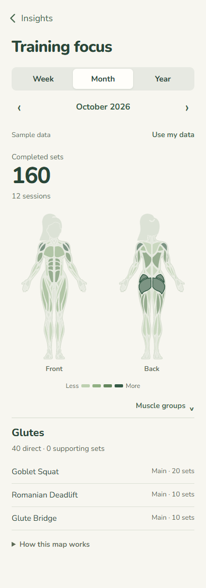
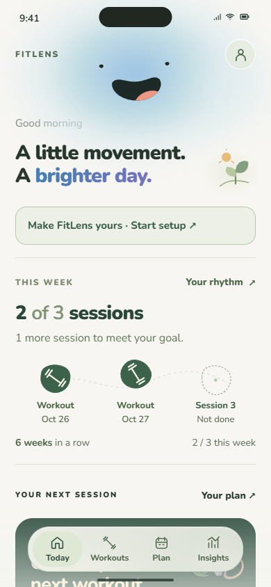
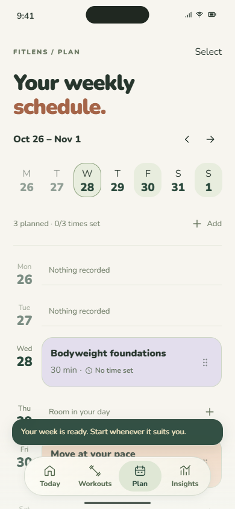
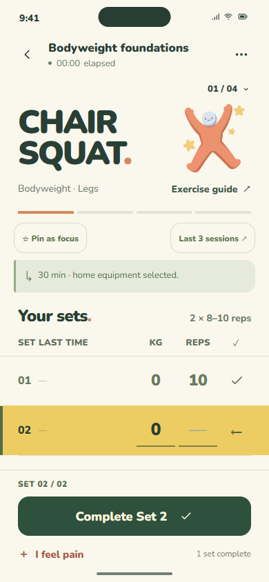
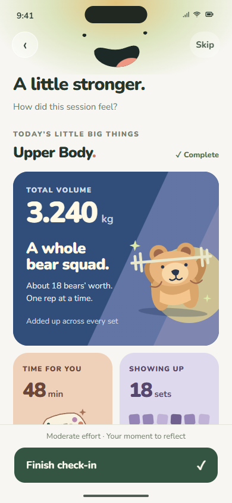
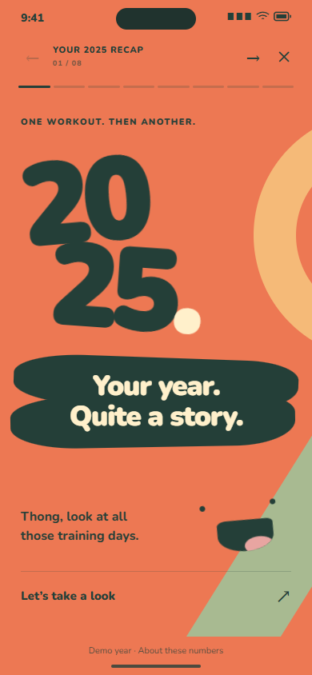
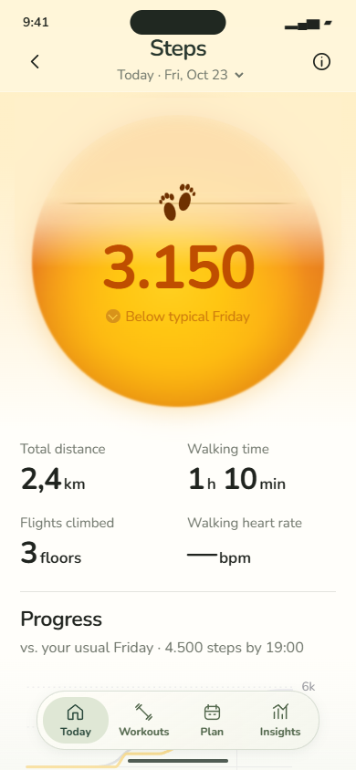
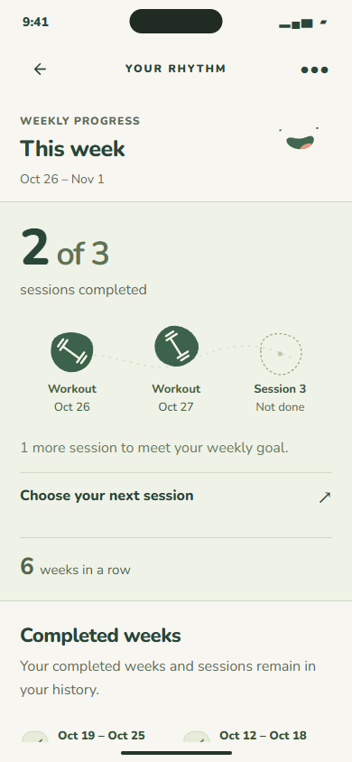
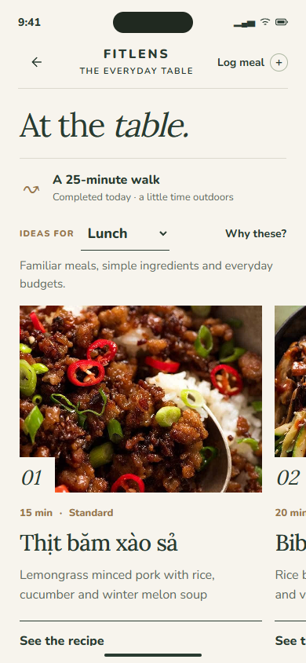

# FitLens — Hướng dẫn demo cho người thuyết trình

**Bản bàn giao: 28/10/2026 · Prototype giao diện mobile · Tiếng Việt cho người demo, giao diện tiếng Anh.**

FitLens giúp người dùng tạo nhịp vận động phù hợp, ghi nhận cảm nhận sau buổi tập và tìm gợi ý ăn uống, kiến thức liên quan. Điểm nhấn là cách trình bày gần gũi: mascot có biểu cảm, số liệu gắn với hình minh họa và không khuyến khích tập bất chấp đau.

Đây là **HTML/CSS/JavaScript prototype tương tác**, chưa phải ứng dụng điện thoại kết nối thiết bị. Đọc mục 1–4 trước để trình bày; các mục sau dùng khi diễn tập hoặc trả lời câu hỏi. Các ảnh bên dưới được chụp từ chính bản sao này. Xem [biên bản kiểm tra](docs/demo/VALIDATION.md) để biết phạm vi đã thử.

## 1. Mở và chuẩn bị trong 5 phút

1. Clone hoặc tải ZIP repo, giải nén; mở terminal tại thư mục có `home.html`.
2. Nếu đã cài Python, chạy:

   ```sh
   python -m http.server 8000 --bind 127.0.0.1
   ```

   Trên Windows có thể dùng `py -m http.server 8000 --bind 127.0.0.1` nếu máy dùng lệnh `py`.
3. Mở [http://127.0.0.1:8000/](http://127.0.0.1:8000/). Nếu máy không có Python, dùng Live Server của VS Code và giữ cùng một địa chỉ trong cả buổi.
4. Dùng Chrome hoặc Edge trên laptop. Nhấn F12 → bật thanh mô phỏng điện thoại → chọn **Responsive, 390 × 844**, mức zoom trang 100%. Thu phóng phần xem trước cho vừa chiều cao màn hình trình chiếu. Không cần giả lập camera hoặc GPS.
5. Đợi font và ảnh hiện đủ. Đóng thông báo hệ điều hành, thử trình chiếu và kiểm tra con trỏ đủ dễ nhìn.
6. Mở sẵn các đường dẫn trong mục 2. Chạy thử các thao tác ở mục 3 trước khi lên lớp.

**Nếu chỉ xem nhanh:** mở `home.html` trực tiếp cũng có thể hiển thị, nhưng demo chính thức nên chạy bằng server để địa chỉ và dữ liệu trình duyệt ổn định. Sau khi server đã chạy và tải trang, các tài nguyên UI chính nằm trong repo; không cần gọi AI, bản đồ hay Health trực tuyến.

### Mới: Training focus và hồ sơ

- Trong **Insights**, bấm thẻ **Training focus** có các lớp xanh để mở heatmap mẫu. Đường dẫn dự phòng: [Training focus — dữ liệu mẫu](http://127.0.0.1:8000/training-focus.html?demo=1&period=month).
- Chọn **Week / Month / Year**, chạm một vùng cơ rồi xem bài tập đóng góp bên dưới. Kịch bản nhanh: Month → chạm vùng lưng → Year, khoảng 10 giây trong phần Insights hiện có; không kéo dài tour 4 phút.
- Mẫu cố định đến **28/10/2026**: tuần 28 set, tháng 10 có 160 set trong 12 buổi, năm 2026 có 1.752 set. Tháng 9 có 12 buổi / 204 set, khớp biểu đồ recap tháng. Có nhãn **Sample data**; đây là dữ liệu minh họa, không phải dữ liệu cá nhân hay số đo cơ thể.
- **Use my data** chuyển về các set thực sự đánh dấu hoàn thành trong trình duyệt. Xem mẫu không ghi thêm buổi tập vào lịch sử; kỳ chưa có log sẽ trống.
- Heatmap cũng nằm trong **chi tiết workout/từng bài** (planned sets) và **recap sau tập** (completed sets). Các vùng Lats, Traps, Upper back và Lower back được chia riêng; màu là mức nhấn mạnh tương đối trong từng kỳ, không phải hồi phục cơ.
- Đổi hình cơ thể nam/nữ tại **Profile → Body illustration**, không phải trên biểu đồ. Có [thiết lập ban đầu tùy chọn](http://127.0.0.1:8000/welcome.html); có thể bỏ qua để bắt đầu demo ngay. Không cần trình bày toàn bộ setup trong 4 phút.



## 2. Thứ tự mở trang và chọn thời lượng demo

**Tour UI có cả lịch tập, workout và những màn thị giác nổi bật.** Không cần hoàn tất một chu trình nghiệp vụ trong 4 phút; mỗi chặng chọn một tương tác tiêu biểu.

| Thứ tự | Trang | Dùng thế nào |
|---|---|---|
| 1 | [Today](http://127.0.0.1:8000/home.html) | Bắt đầu và quay lại xem tiến độ sau buổi tập. Dùng trạng thái thật của prototype, không thêm `preview`. |
| 2 | [Plan](http://127.0.0.1:8000/plan.html) | Gợi ý tuần, xem bản nháp, Apply week và mở một buổi. |
| 3 | Chi tiết buổi → đang tập → recap | Đi tiếp từ Plan trong **cùng một tab** để giữ đúng buổi và số hiệp vừa nhập. Không mở recap mẫu thay cho kết quả của luồng này. |
| Dự phòng | [Thư viện Workouts](http://127.0.0.1:8000/workouts.html) | Chọn một workout nếu không còn ngày phù hợp để demo từ lịch. |
| Mở rộng | [Steps](http://127.0.0.1:8000/steps.html), [Rhythm](http://127.0.0.1:8000/streak.html?preview=active) | Mặt trời, biểu đồ bước chân, tiến độ tuần và lịch sử. |
| Mở rộng | [Food](http://127.0.0.1:8000/food.html?preview=walk) | Danh mục 30 món, công thức và tìm kiếm/lọc. |
| Kết | [Insights](http://127.0.0.1:8000/insights.html) → [recap năm](http://127.0.0.1:8000/yearly-recap.html) | Thẻ kiến thức và story năm với chuyển màu, minh họa, poster. |

- **Thời lượng đã chốt: 4 phút cho UI.** Dùng bảng thời gian ở mục 3, mở sẵn các tab để giảm thời gian điều hướng.
- **Khi được hỏi sâu:** dùng các hướng dẫn chi tiết ở mục 4. Chúng không nằm trong đồng hồ 4 phút.
- Luồng Plan → Workout → recap thực đã được kiểm tra, nhưng trong tour được phép chuyển sang màn mẫu để giới thiệu thiết kế nếu nói rõ ngữ cảnh.



## 3. Kịch bản chính — tour UI đúng 4 phút

**Mục tiêu buổi trình bày:** cho thấy độ phủ và chất lượng thiết kế, hiệu ứng, tương tác tiêu biểu. Đây là tour các màn UI; không cần thao tác xong cả một buổi tập hoặc tạo đủ dữ liệu để mở màn tiếp theo. Luồng liên thông đã kiểm tra được ghi ở mục 4 và biên bản kiểm tra để tra cứu khi được hỏi.

### Chuẩn bị trước khi lên trình bày

- Mở sẵn các tab theo đúng thứ tự bảng dưới, cùng một cửa sổ và cùng kích thước mobile. Kiểm tra ảnh/font đã tải đủ; đừng dành thời gian gõ URL trước lớp.
- **Plan:** diễn tập tạo gợi ý trước. Giữ một tuần đã Apply hoặc một bản nháp đang chờ Apply để có thẻ lịch ngay khi mở. Không điền cả biểu mẫu Focus/Week/Setup trong 4 phút.
- **Workout:** mở sẵn `workout-details.html` hoặc chi tiết buổi từ Plan. Nếu muốn minh họa ghi hiệp, chuẩn bị sẵn giá trị KG/REPS hợp lệ; chỉ bấm hoàn thành một hiệp.
- **Recap sau tập:** mở riêng `workout-review.html` để xem đầy đủ thiết kế mẫu với gấu/mascot. Nói một lần đầu buổi rằng một số màn đang dùng dữ liệu minh họa; không nhận các số mẫu là kết quả của hiệp vừa bấm.
- **Steps / Rhythm:** mở sẵn `steps.html` và `streak.html?preview=active`. Bản hiện tại đã bỏ recap route cũ; `post-walk-restored.html` chỉ chuyển về Steps.
- **Recap năm:** mở sẵn `yearly-recap.html`; tập chọn chương bằng các đoạn tiến độ. Dừng ở bìa trước khi bắt đầu tour. Không chờ chạy đủ 8 chương.
- Có thể mở thêm tab Camera và Monthly recap để thay thế một đoạn nếu đó là phần muốn nhấn mạnh; không cộng thêm thời gian vào lịch 4 phút.

### Phân bổ thời gian — mỗi chặng một điểm nhấn

| Mốc | Màn và thao tác cần show | Lời dẫn ngắn |
|---|---|---|
| **0:00–0:15** | **Today:** mascot, màu thương hiệu và nhịp tuần. Cuộn một nhịp tới các khối hoạt động. | “Đây là tổng quan ngày, gom tiến độ và gợi ý tiếp theo. Một số màn trong tour dùng dữ liệu mẫu để trình diễn UI.” |
| **0:15–0:40** | **Plan:** cho xem lịch có sẵn; mở một buổi hoặc chỉ nhanh bản nháp rồi Apply. Nếu đã diễn tập, minh họa đổi ngày/giờ bằng một thao tác. | “Lịch có thể được gợi ý, xem trước và chỉnh lại theo thời gian của người dùng.” |
| **0:40–1:10** | **Workout:** lướt danh sách bài trong chi tiết → Start Workout → nhập/đánh dấu một hiệp, thấy rest panel → Skip rest. | “Trong buổi tập có bài hiện tại, ghi sets/reps và nghỉ giữa hiệp.” |
| **1:10–1:20** | **Camera:** mở Check my form hoặc tab chuẩn bị sẵn; cho xem khung minh họa, rồi chuyển tab recap. | “Đây là thiết kế camera hỗ trợ form; hiện chưa bật nhận diện thật.” |
| **1:20–1:45** | **Recap sau tập:** mẫu gấu và các khối thống kê; kéo effort để mascot đổi biểu cảm. Dừng một nhịp ở biểu cảm mới. | “Phần tổng kết kết hợp số liệu với cảm nhận người dùng; mascot phản hồi theo mức độ mệt.” |
| **1:45–2:20** | **Steps / Rhythm:** 20 giây cho mặt trời, Progress và đổi Steps/Distance/Flights; 15 giây cho tiến độ **2 of 3**, icon workout và Completed weeks. | “Bước chân có tổng quan theo ngày; Rhythm ưu tiên tiến độ tuần rồi mới đến số tuần liên tiếp.” |
| **2:20–2:40** | **Food:** vuốt hàng món ăn → mở một công thức → lướt nguyên liệu/cách làm. | “Gợi ý ăn uống đi cùng công thức và cách ghi lại bữa ăn.” |
| **2:40–2:55** | **Insights:** lướt một hàng thẻ → mở bài → đóng. | “Kiến thức có trong thư viện và cuối các màn liên quan, dùng chung mẫu thẻ và phần đọc.” |
| **2:55–3:45** | **Recap năm:** bìa → chương **Your familiar moves** → so sánh khối lượng **Heavier than you think** → poster **Your year, to keep**. | “Recap kể hành trình bằng chuyển động, minh họa và poster. Đây là một năm giả lập để thể hiện thiết kế.” |
| **3:45–4:00** | Giữ poster cuối, kết thúc; không mở thêm luồng. | “Tour vừa rồi đi qua lập lịch, tập luyện, cảm nhận, đi bộ, ăn uống và kiến thức. Bước tiếp theo là hoàn thiện các tích hợp thật.” |

### Chuyển màn nhanh mà vẫn dễ hiểu

- Mỗi chặng chỉ làm **một tương tác có tác dụng rõ**, không bấm mọi nút. Đợi hiệu ứng đổi trạng thái hiện lên rồi mới đi tiếp.
- Tab chuẩn bị sẵn giúp bỏ thời gian điều hướng; không dùng để giả vờ dữ liệu giữa các màn đã liên thông. Nếu chuyển sang recap mẫu, gọi đúng là “thiết kế phần recap”.
- Nếu chậm hơn kịch bản: bỏ đoạn Camera 10 giây hoặc rút Food xuống một màn; ưu tiên giữ Plan, Workout, mascot và đoạn kết recap năm. Không tăng tốc nói đến mức người xem không kịp nhìn.
- **Không cố show đủ 19 trang trong 4 phút.** Tour đã phủ hầu hết các nhóm tính năng quan trọng; Profile, Chat, lịch sử Workouts, Rhythm chi tiết, Reminders và Monthly recap để trong phần hỏi đáp.
- Nếu muốn thay một đoạn: **Monthly recap** thay cho Camera + một phần Food (khoảng 20 giây); **Rhythm** thay cho một phần Walk (khoảng 15 giây). Dùng bản đã diễn tập, không chọn thay ngay trên sân khấu.
- Khi được yêu cầu dừng lại, dừng và giải thích. Mục giới hạn cùng các bước nghiệp vụ chi tiết nằm bên dưới; không dựa vào tốc độ lướt để xử lý một tính năng đang lỗi.

### Những điểm đẹp nên để người xem kịp nhìn









## 4. Phần mở rộng — giữ những màn đẹp và có hướng dẫn chi tiết

Các đoạn dưới là tài liệu tra cứu cho tour và phần hỏi đáp. Mốc 4 phút chỉ dùng bảng ở mục 3; không đọc hoặc thực hiện toàn bộ phần này trên sân khấu.

### Steps: số liệu có ngữ cảnh

- **Thao tác:** bấm thẻ **Steps**; nhìn mặt trời, cuộn xuống Progress và Short-term overview. Chuyển **Steps → Distance → Flights**. Chỉ thử 1–2 điểm trên Progress để minh họa đọc số liệu.
- **Lời dẫn:** “Số bước được đặt cạnh thói quen thường ngày, không chỉ một ngưỡng cố định. Người dùng có thể xem diễn biến trong ngày và tổng quan nhiều ngày.”
- **Lưu ý:** Steps dùng bộ dữ liệu mẫu cố định tháng 10/2026; “Today” ở màn này không tự chuyển theo ngày máy. Flights là dữ liệu mẫu. Không nói đang đọc trực tiếp Apple Health.
- **Cuộn cuối:** có **More about walking**. Mở một bài rồi đóng để cho thấy quay lại nguyên vị trí. Recorded walk/recap route cũ đã được loại khỏi màn hiện tại.



### Rhythm: tiến độ tuần và lịch sử dễ đọc

- Mở `streak.html?preview=active`: nhìn **2 of 3 sessions completed**, icon và nhãn buổi, số tuần liên tiếp ở bên dưới.
- Chuyển sang `?preview=complete` hoặc `?preview=recovery` nếu muốn minh họa đủ mục tiêu/nghỉ. Không giả vờ các URL mẫu phản ánh buổi vừa tập.
- **Completed weeks** hiển thị khoảng ngày và số buổi; bấm một tuần để xem danh sách buổi có ngày và tên. Dấu tick là đánh dấu hoàn thành, không còn mã hóa walk/workout bằng chấm cao/thấp.



### Food: chăm sóc cả phần ăn uống

- **Mở:** tab `food.html?preview=walk`.
- **Thao tác:** lướt hàng món gợi ý; chọn một món; xem nguyên liệu và cách làm. Quay lại; nếu cần, tìm `trứng` trong ô **Dish or ingredient**.
- **Lời dẫn:** “Gợi ý món ăn được gắn với ngữ cảnh sinh hoạt. Người dùng có thể tìm món, xem công thức và ghi lại bữa ăn thay vì phải nhập calo chính xác.”
- **Lưu ý:** preview Walk là ngữ cảnh giả lập; danh mục và luật gợi ý chạy cục bộ. Đây chưa phải tư vấn dinh dưỡng cá nhân từ AI. Ảnh món ăn là tài nguyên demo; không tuyên bố toàn bộ ảnh do nhóm chụp.



### Insights và kiến thức đúng ngữ cảnh

- **Mở:** tab Insights; cuộn tới **Daily Insights**.
- **Thao tác:** vuốt một hàng thẻ, mở bài và đóng.
- **Lời dẫn:** “Kiến thức được đọc trong Insights và cũng xuất hiện cuối những màn liên quan. Cùng một bài dùng chung nội dung và giao diện đọc.”
- **Lưu ý:** bài viết hiện là nội dung mẫu của thư viện prototype; không trình bày như tài liệu y khoa đã thẩm định.

### Recap năm: kết thúc bằng phần thị giác nổi bật nhất

- **Thao tác:** trở lại đầu Insights, bấm thẻ recap năm **2025**, hoặc dùng tab đã mở sẵn.
- **Nên cho xem:** bìa **Your year in motion**; chương **Your familiar moves** (các bài tập quen thuộc); chương **Heavier than you think** (so sánh khối lượng); chương cuối **Your year, to keep** (poster). Không cần diễn đủ cả 8 chương.
- **Điều khiển:** dùng mũi tên đầu trang hoặc các đoạn tiến độ để chọn chương. Story có tự chạy; giữ tay/con trỏ nhấn trên vùng nội dung để tạm dừng khi cần nói, thả để tiếp tục. Dùng nút điều hướng là cách chắc chắn khi đang trình chiếu.
- **Lời dẫn:** “Những hoạt động nhỏ được kể thành một câu chuyện dài hạn. Recap biến dữ liệu thành ký ức và một poster có thể lưu lại.”
- **Kỳ vọng:** màu nền, minh họa và thống kê thay đổi theo chương. Nút **Save your poster** tải tệp; chỉ bấm nếu đã diễn tập tải tệp trên máy trình chiếu.
- **Phải nói rõ:** đây là **năm 2025 giả lập**; không tổng hợp từ các hoạt động vừa nhập và không phải sức khỏe của người thuyết trình.


### A. Plan — thể hiện luồng nghiệp vụ, khoảng 1–2 phút

1. Mở `plan.html`. Nếu lịch đã có dữ liệu cũ, xem mục 6 trước; không reset ngay khi đang trình bày.
2. Bấm **Suggest my week.**; đi qua **Focus → Week → Setup**. Chọn mục tiêu, số buổi, thời lượng, ngày, nơi tập và dụng cụ bằng các lựa chọn đang hiện.
3. Bấm **Preview my week**. Cho xem nhãn bản nháp và các buổi được gợi ý; bấm **Apply week** để áp dụng.
4. Có thể mở một buổi, đổi ngày hoặc đặt giờ. **Set times together** minh họa đặt giờ chung cho các buổi còn thiếu giờ.
5. Giải thích: lịch được tạo từ danh mục và luật cục bộ theo lựa chọn, **không gọi LLM**. Nếu tuần hiện tại còn quá ít ngày, chọn tuần tới bằng mũi tên hoặc **Plan next week** khi được gợi ý.
6. Nếu có bản nháp cũ, trang sẽ đề nghị **Review draft**. Xử lý nó trong lúc chuẩn bị, không coi đây là lỗi.

### B. Workouts — thư viện và lịch sử tập

- Tab đáy hiện là **Today / Workouts / Plan / Insights**.
- Mở `workouts.html`: chọn workout, xem lịch sử và các tùy chọn ghi buổi thủ công đang hiện. Nhập dữ liệu demo hợp lệ; không nhập ngày tương lai.
- `activity.html` là đường dẫn tương thích cũ, hiện chuyển về Workouts; không dùng nó để giới thiệu một tab riêng.
- Steps là tổng bước trong ngày, không tự biến thành một workout. Recap route đi bộ cũ đã bỏ khỏi bản hiện tại.

### C. Workout → Camera → Review

- `workouts.html` → chọn tên một bài → chi tiết bài → **Start Workout**.
- Trong màn đang tập có nhập số, đánh dấu hiệp, nghỉ và báo đau. Chỉ chạy một phần ngắn nếu chưa diễn tập hoàn tất cả buổi.
- Camera có màn thiết lập, khung người minh họa và trạng thái **Ready / Adjust view**. **Camera đang tắt:** không quay, không đếm rep, không chấm tư thế.
- Nút báo đau dừng buổi và Pause Rhythm; không dùng trong kịch bản vui vẻ chính vì nó thay đổi trạng thái nghỉ. Khi được hỏi về an toàn, mở một lượt riêng và giải thích rõ.
- Recap đẹp có thể mở trực tiếp `workout-review.html` nếu không đủ thời gian hoàn thành buổi tập; nói rõ đang xem mẫu.

### D. Rhythm — dùng trạng thái mẫu, không đợi tích lũy nhiều tuần

| Trạng thái | Đường dẫn |
|---|---|
| Bắt đầu | `streak.html?preview=new` |
| Đang theo mục tiêu | `streak.html?preview=active` |
| Đủ mục tiêu | `streak.html?preview=complete` |
| Nghỉ phục hồi | `streak.html?preview=recovery` |
| Trở lại | `streak.html?preview=comeback` |

Preview tách khỏi tiến độ thật đang lưu; không dùng các trang mẫu để chứng minh cộng buổi trực tiếp. Muốn thử dữ liệu thật của prototype, dùng `streak.html` không có `preview` và đặt mục tiêu trước.

Đủ số buổi là tuần được tính hoàn thành ngay, không phải đợi Chủ Nhật. Tuần Pause giữ chuỗi trước đó nhưng không tăng tuần hoàn thành. Tuần thiếu mục tiêu không được bảo vệ sẽ ngắt chuỗi; lịch sử vẫn giữ. Chưa có XP, vật phẩm hay khiên tích lũy.

### E. Những phần đẹp khác

- **Monthly recap:** Insights → thẻ **September**, hoặc `monthly-recap.html`. Có 2 trang; vuốt hoặc dùng phím trái/phải trên vùng story. Trang biểu đồ cần một nhịp để chạy hoạt ảnh.
- **Bộ phận cơ thể trong workout review:** xem tổng quan cơ và các góc nhìn; phần báo khó chịu cho chọn vùng và ghi nhận phản hồi.
- **Chat:** mở từ ngữ cảnh Food hoặc bài tập. Dùng câu hỏi gợi ý sẵn; câu trả lời là mẫu cục bộ, không phải AI trực tuyến.
- **Profile:** `profile.html` thể hiện hồ sơ, dụng cụ, mục tiêu và vùng cơ thể cần lưu ý. Đây là nhánh giải thích cá nhân hóa; không nhất thiết đưa vào tour 4 phút.

## 5. Bản đồ các màn hiện có

| Nhóm | File | Vai trò |
|---|---|---|
| Tổng quan | `home.html` | Trang bắt đầu; Steps, nhịp tuần, gợi ý tập, Food. |
| Hoạt động | `workouts.html` | Thư viện và lịch sử tập; `activity.html` chuyển về đây. |
| Lịch | `plan.html` | Lên lịch, gợi ý, áp dụng và điều chỉnh tuần. |
| Chi tiết và buổi tập | `workout-details.html`, `workout-active.html` | Nội dung buổi tập và ghi các hiệp. |
| Camera | `camera-setup.html` | Thiết lập mô phỏng bằng hình minh họa. |
| Sau tập | `workout-review.html` | Tổng kết, độ mệt, cơ thể và ghi chú. |
| Bước chân | `steps.html` | Tổng hợp bước chân; `post-walk-restored.html` là chuyển hướng cũ. |
| Dinh dưỡng | `food.html` | Gợi ý, tìm món, công thức, nhật ký bữa ăn. |
| Kiến thức | `insights.html` | Recap và thư viện bài viết. |
| Story | `yearly-recap.html`, `monthly-recap.html` | Recap năm 2025 / tháng 9/2026 giả lập, độc lập nhau. |
| Động lực | `streak.html` | Weekly Rhythm và lịch sử tuần. |
| Cá nhân | `profile.html`, `chat.html` | Hồ sơ và hội thoại mẫu theo ngữ cảnh. |
| Luồng thiết lập cũ | `setup-plan.html`, `reminders.html` | Vẫn có trong bản sao để liên kết cũ không đứt; kịch bản chính dùng Plan mới. |

Các nghiên cứu hình ảnh cũ như `steps-orb-study.html`, `post-walk.html`, `face-expressions.html` không thuộc đường demo chính và không được đưa vào bản sao hiện hành.

## 6. Dữ liệu, chuẩn bị và reset

- Dữ liệu nằm trong `localStorage` hoặc `sessionStorage` của trình duyệt; không có tài khoản/backend. Profile, lịch, lịch sử hoạt động, Rhythm và bữa ăn có thể còn sau khi tải lại. Một số trạng thái buổi tập/check-in/hội thoại phụ thuộc tab.
- Dùng **cùng trình duyệt, địa chỉ và cổng** trong cả buổi. `localhost`, `127.0.0.1`, cổng 8000 và cổng Live Server có thể tạo các vùng dữ liệu khác nhau.
- Dùng dữ liệu demo, không nhập thông tin sức khỏe thật. Các trạng thái `?preview=...` là fixture có sẵn, không sửa thành tích đã lưu.
- Cách chuẩn bị sạch dễ nhất: mở một cửa sổ ẩn danh mới, chạy đúng địa chỉ server, diễn tập và giữ cửa sổ đó đến hết buổi. Đóng toàn bộ cửa sổ ẩn danh sẽ làm mất dữ liệu của phiên đó.
- Muốn reset phiên đang dùng: chỉ thực hiện trước diễn tập/demo, mở DevTools → **Application → Storage**, chọn đúng địa chỉ prototype và xóa dữ liệu của trang đó, rồi tải lại. Việc này xóa cả các chỉnh sửa demo đã lưu ở địa chỉ đó; không dùng nếu cần giữ chúng.
- Preview Rhythm có thể đổi trạng thái bằng URL; không cần tạo giả nhiều tuần lịch sử. Dữ liệu Steps, recap tháng và recap năm không đồng bộ với những thay đổi bạn vừa nhập.

## 7. Giới hạn cần biết để trả lời đúng

| Phần | Có thể cho xem | Không nên khẳng định |
|---|---|---|
| Plan | Gợi ý từ lựa chọn, bản nháp, chỉnh và áp dụng lịch | AI đã phân tích sức khỏe rồi kê lịch cá nhân. |
| Camera | Khung thiết lập, trạng thái minh họa | Camera đang nhận diện và đếm rep thật. |
| Steps / Flights | Biểu đồ và dữ liệu mẫu | Đang đồng bộ Health hoặc cảm biến điện thoại. |
| Steps | Tổng bước, Progress, overview, bài kiến thức | Có GPS/recap route đi bộ trong bản hiện tại. |
| Báo đau | Nút trong lúc tập dừng buổi và Pause Rhythm | Mọi ghi chú “khó chịu” ở mọi màn đã đồng bộ bảo vệ chuỗi. |
| Reminders | Chọn giờ và giao diện nhắc | Máy sẽ phát thông báo khi đến giờ. |
| Chat | Hội thoại theo ngữ cảnh, phản hồi mẫu | Đang kết nối LLM hoặc có tư vấn y tế. |
| Recap | Hình ảnh, animation, biểu đồ, poster | Story 2025 được tổng hợp từ dữ liệu vừa nhập năm 2026. |
| Ảnh/bài viết | Tài nguyên minh họa và nội dung mẫu đã có | Tất cả ảnh có giấy phép tái sử dụng hoặc bài đã thẩm định y khoa. |

Chưa có xác minh đầy đủ quyền sử dụng ảnh Food; ghi chú nguồn có trong `assets/food/SOURCES.md` và `assets/food/demo/SOURCES.md`. Bản sao giữ tài nguyên hiện tại để đồng nhất với bản demo. Trước khi dùng thương mại hoặc phân phối rộng hơn, cần rà soát nguồn/quyền và nội dung sức khỏe. Các ghi chú nguồn không phải chứng nhận bản quyền.

## 8. Câu hỏi thường gặp khi bảo vệ

**“App này đã hoàn chỉnh chưa?”** — “Đây là prototype tương tác để kiểm chứng luồng và trải nghiệm. Dữ liệu, tích hợp thiết bị và dịch vụ sẽ được triển khai ở ứng dụng thật.”

**“Điểm khác biệt chính là gì?”** — “Kết nối vận động với cảm nhận cơ thể, ăn uống và kiến thức trong một trải nghiệm gần gũi. Việc nghỉ được thể hiện rõ thay vì chỉ thúc người dùng tập thêm.”

**“Vì sao đếm theo tuần?”** — “Mục tiêu theo số buổi cho phép linh hoạt ngày tập. Đạt đủ mục tiêu là tính ngay; nghỉ được bảo vệ khác với một tuần hoàn thành.”

**“Số tầng có lấy thật được không?”** — “Ứng dụng điện thoại có thể đọc dữ liệu tương ứng khi thiết bị/dịch vụ có dữ liệu và người dùng cấp quyền. Trong prototype đang dùng số mẫu.”

**“Steps có GPS hoặc route không?”** — “Bản hiện tại chỉ demo số bước tổng hợp và biểu đồ. Recap route cũ đã bỏ; tích hợp GPS nằm ngoài bản bàn giao này.”

**“Không có mạng có chạy được không?”** — “Phần UI chính và dữ liệu demo được phục vụ từ máy local. Các liên kết nguồn bên ngoài vẫn cần mạng. Chưa triển khai chế độ offline của ứng dụng thật.”

**“Calo và những phép so sánh chính xác không?”** — “Đó là dữ liệu minh họa và phép ví von được ghi chú. Chúng không dùng để chẩn đoán hoặc đánh giá sức khỏe cá nhân.”

## 9. Checklist trước buổi demo và phương án dự phòng

- [ ] Đã tải đúng phiên bản repo; không lấy nhầm bản đầu thiếu Activity/Plan/recap năm.
- [ ] Server chạy; `home.html`, Food và recap năm tải được font, ảnh, icon.
- [ ] Đã thử bằng đúng máy, trình duyệt, màn hình chiếu và kích thước điện thoại sẽ dùng.
- [ ] Đã mở các tab theo thứ tự; biết URL quay về khi lỡ thao tác.
- [ ] Đã diễn toàn bộ kịch bản một lần, bấm nút thật và đọc lời dẫn thành tiếng.
- [ ] Đã bấm giờ đúng 4 phút cho tour UI và mở sẵn các tab theo thứ tự mục 3.
- [ ] Có bản ZIP local; không phụ thuộc tải GitHub trong lớp.
- [ ] Nếu cần video dự phòng: quay màn hình một lượt demo đã chạy thành công. **Repo chưa kèm video demo.**

**Khi gặp vấn đề:** nếu sai trạng thái, dùng tab dự phòng/URL đã chuẩn bị; nếu story chuyển nhanh, dùng mũi tên để chọn lại; nếu ảnh chưa hiện, chờ tải hoặc tải lại trước khi nói tiếp. Nếu một bước không hoạt động, nói ngắn “phần này đang ở mức prototype” và chuyển sang màn đã kiểm tra. Không bấm ngẫu nhiên hoặc cố làm người xem không nhận ra lỗi.

Sau diễn tập, hạn chế sửa sát giờ. Nếu vừa cập nhật repo, chạy lại toàn bộ đường demo; tài liệu không thay thế việc thử trên máy thuyết trình.

## 10. Ghi chú cho người cập nhật dự án

- Mỗi màn dùng HTML/CSS/JS thuần; ảnh và font nằm trong `assets/`. Không cần npm build.
- `training-model.js`, `activity-model.js`, `rhythm-model.js`, `profile-model.js`, `food-model.js` quản lý trạng thái prototype cục bộ.
- `fitlens-ui.css` chứa các quy tắc font/lề/điều khiển chức năng dùng chung; `insights-data.js` chứa thư viện bài chung; `related-insights.js` và `related-insights.css` cung cấp hàng bài liên quan/phần đọc cho nhiều màn.
- Đây là **bản sao để chia sẻ**, tách khỏi workspace thiết kế. Không đưa thư mục handoff, dữ liệu kết nối, secret hoặc tài liệu riêng vào repo.
- Trong workspace gốc, tài liệu nguồn là `public-share/DEMO_README.md`; công cụ `public-share/build_public_snapshot.py` cập nhật bản sao và README. Sửa tài liệu nguồn trước lần đồng bộ tiếp theo để không ghi đè hướng dẫn mới.
- `docs/demo/` chứa ảnh chụp từ bản sao. Khi giao diện thay đổi đáng kể, chụp lại ảnh và thử lại các bước liên quan.
- Mốc kiểm tra này: 27/10/2026. Phần giới hạn mô tả bản bàn giao tại mốc này; cần cập nhật khi các tích hợp thật được hoàn thành.
